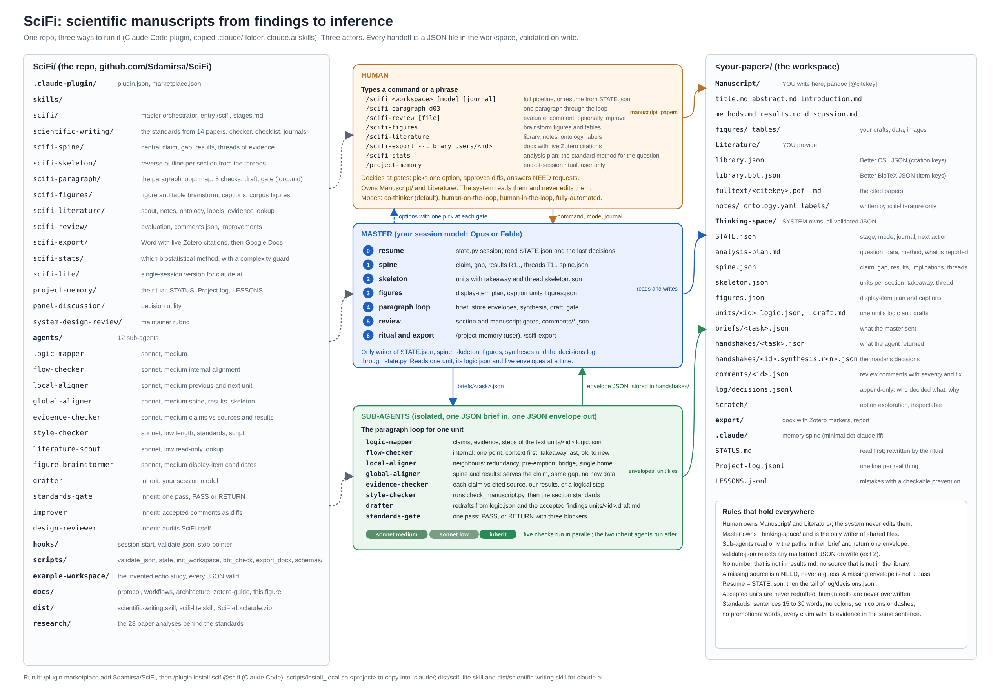

# SciFi: scientific manuscripts from findings to inference

SciFi is a Claude Code plugin for writing, revising and evaluating scientific manuscripts. It
makes the paper's central claim and its threads of evidence explicit, builds a reverse outline
from them, and then works one paragraph at a time: a logic map, five isolated checks, a draft
by the model you chose, and one gate against written standards. Every handoff is a JSON file
in your workspace, so each decision can be inspected and a session can resume from disk. It
never edits your manuscript or your literature folder.



## What it does

1. **Spine**: one central claim, the gap, the results with their numbers, the implications, and the threads linking them.
2. **Skeleton**: a reverse outline, each paragraph with a takeaway and the thread it serves.
3. **Figures**: a display-item plan with captions.
4. **Paragraph loop**: logic map, five checks (flow, local, global, evidence, style), synthesis, draft, standards gate.
5. **Review**: reviewer-style comments with location and rule, a verdict, and optional minimal diffs.
6. **Ritual**: `/project-memory` logs the session, curates lessons and sets the next action.

## Install

| Route | Command |
|---|---|
| Plugin (marketplace) | `/plugin marketplace add Sdamirsa/SciFi` then `/plugin install scifi@scifi` |
| Plugin (local clone) | `claude --plugin-dir /path/to/SciFi` |
| Copy into a project | `bash scripts/install_local.sh /path/to/project` |
| claude.ai | upload `dist/scientific-writing.skill` and `dist/scifi-lite.skill` |

Details and verification in [docs/installation.md](docs/installation.md). What works on
claude.ai is in [docs/claude-ai.md](docs/claude-ai.md).

## Quick start

```bash
cp -r example-workspace ~/scifi-demo
cd ~/scifi-demo && claude
```

Then type `/scifi example-workspace co-thinker lancet`. The example is an invented echocardiography study; no
real data is in the repo. The full walkthroughs (first session, resume, evaluate a manuscript,
one paragraph, end of session) are in [docs/workflows.md](docs/workflows.md).

## Folder map

```
.claude-plugin/     plugin.json, marketplace.json
skills/
  scifi/            master orchestrator, entry /scifi
  scientific-writing/  the standards: global rules, sections, figures, journals, checklist, checker
  scifi-spine/      central claim, gap, results, threads
  scifi-skeleton/   reverse outline from the threads
  scifi-paragraph/  the paragraph loop
  scifi-figures/    figure and table plan, captions
  scifi-literature/ library building, notes, ontology, labels, evidence lookup
  scifi-review/     evaluation, comments, improvements
  scifi-export/     Word with live Zotero citations, then Google Docs
  scifi-stats/      which biostatistical method, with a complexity guard against bespoke methods
  scifi-lite/       single-session version for claude.ai
  panel-discussion/ decision utility
  project-memory/   the end-of-session ritual
  system-design-review/  maintainer rubric
agents/             the sub-agents (checkers, drafter, gate, improver, design-reviewer)
hooks/              session-start, validate-json, stop-pointer
scripts/            validate_json, init_workspace, state, bbt_check, export_docx, install_local; schemas/
example-workspace/  what a user folder looks like
docs/               protocol, workflows, architecture, installation, claude-ai, zotero-guide
dist/               the .skill packages for claude.ai
research/           the paper analyses behind the standards
```

How the parts fit and why: [docs/architecture.md](docs/architecture.md). The contracts:
[docs/protocol.md](docs/protocol.md).

## Predecessors

SciFi replaces three earlier projects by the same author.

- **discursus-SKILL** (archived): the spine, the reverse outline, the paragraph loop, the four control modes and the decisions log.
- **crystalit-SKILL** (archived): its library building, notes, ontology and labels became the stages of `scifi-literature`; its figure library became the corpus mode of `scifi-figures`; `panel-discussion` is kept as is; its grounding rule (methods and results only) is now the evidence check's rule; its report writer is replaced by the paragraph loop.
- **dot-claude-iff**: the memory spine (STATUS, Project-log, LESSONS), the `/project-memory` ritual, JSON briefs and envelopes, and the honesty rule.

## Where the standards come from

The `scientific-writing` skill was distilled from 14 published papers (npj Digital Medicine,
JAMIA, Nature-portfolio journals, The Lancet Digital Health, European Heart Journal), each
analysed for its text and for its figures and tables. The analyses are in `research/`, and
`skills/scientific-writing/references/sources.md` lists what each paper contributed and its
known weaknesses. The standards describe patterns; they do not reproduce the papers' text.

## Licence and author

MIT, see [LICENSE](LICENSE). Seyed Amir Ahmad Safavi-Naini ([@Sdamirsa](https://github.com/Sdamirsa)).
