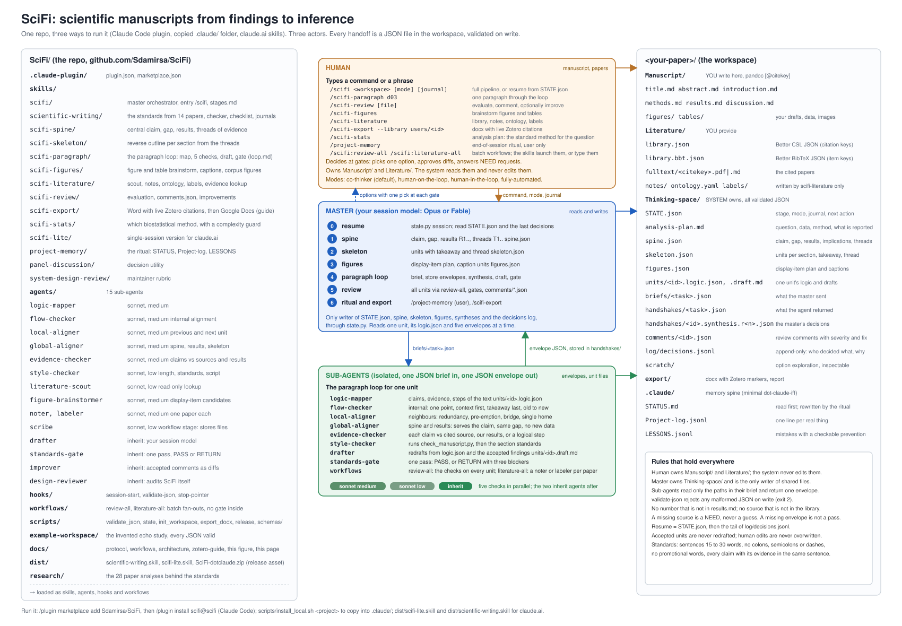

# Architecture

The contracts (actors, workspace layout, brief, envelope, synthesis, modes, model routing,
memory rules) are in [protocol.md](protocol.md). This page explains why the system is shaped
the way it is.

## Design choices

**One spine, many threads.** A paper is one central claim carried by threads of evidence. A
thread opens in the Introduction, is carried by one or more results, and closes in the
Discussion. Making the threads explicit in `spine.json` and `skeleton.json` lets a checker
test a paragraph against the whole paper rather than against taste. Introduction and
Discussion become mirror images, and an unclosed thread or an unsupported closing is a
finding with a location.

**JSON handshakes on disk.** Every dispatch is a brief file and every return is an envelope
file, validated against a schema by a hook on write. The conversation is never the data
source. This makes a round inspectable after the fact, lets a session resume from files
alone, and turns a malformed reply into a rejected write instead of a silent misread.

**Five axes, not seven reviewers.** Earlier designs ran one reviewer per concern. Their
findings overlapped and their scopes blurred. SciFi splits review by what is compared with
what: the paragraph with itself (flow), with its neighbours (local), with the spine and
results (global), with its sources (evidence), and with the standards (style, backed by a
script). Each axis has a non-goal list, so one problem is reported once.

**Sonnet at medium for checkers, your model for prose.** Checks are bounded by one axis and
run in parallel, so a cheaper model at medium effort is enough and keeps a round fast.
Lookups and the script-backed style pass run at low effort. The drafter, the standards gate
and the improver inherit the session model, because prose quality and the final judgement
are where a stronger model pays off. Routing is in protocol section 7.

**One writer.** Agents return findings and write only their own envelope or the unit file
their brief names. The master is the only writer of the spine, the skeleton, the state, the
synthesis and the log. Conflicting edits cannot happen, and every shared change has one
author in the decisions log.

**No edits to `Manuscript/`.** The human owns the manuscript and the literature. Drafts live
in `Thinking-space/units/` with their history, and the human copies what they accept. A
system that cannot overwrite your paper is one you can run in fully-automated mode without
fear.

**Small active memory.** The master reads `STATE.json`, one unit's logic map and its five
envelopes, never the whole workspace. Envelopes carry findings, not text. The standards are
loaded only by the two agents that need them. This keeps long sessions inside the context
budget and keeps resume cheap.

## What came from where

| Source | Taken into SciFi | Left behind |
|---|---|---|
| discursus-SKILL | The spine (one central claim, gap, results and payoff), generalised from the Discussion to the whole paper. The reverse outline as the skeleton. The paragraph loop (design, parallel review, handshake, fixes, gate). The four control modes. The append-only decisions log, STATE, NEED requests, and "agents return findings, the master writes". Its quality rubric merged into the standards; its design-review rubric kept as `system-design-review`. | Markdown handshakes (now JSON). Seven reviewers collapsed into five axes plus a script. |
| crystalit-SKILL | Library building, notes, ontology and labels as the stages of `scifi-literature`. Figure brainstorming and the corpus figure library in `scifi-figures`. `panel-discussion` kept as a decision utility. The Zotero collection structure in the Zotero guide. The "methods and results only" grounding rule, now the evidence-checker's rule. Human checkpoints at every phase. | The report writer (the paragraph loop writes prose instead), the separate skill per phase (one skill with stages, so there is one route per task). |
| dot-claude-iff | The memory spine (STATUS.md, Project-log.jsonl, LESSONS.jsonl), the user-typed `/project-memory` ritual without tickets, the session-start resume hook, the eight-field brief and JSON envelope, the honesty rule, lessons with a checkable prevention. | The console, observability capture, policy gate, record root, worktrees, modes and phases, and its tool test suite. |
| scientific-writing | The standards skill unchanged, with its checker script. The paper analyses behind it moved to `research/`. | |

## Where to change what

| To change | Edit | Then |
|---|---|---|
| a file format | `scripts/schemas/*.json` and protocol.md | update the agents that write it |
| what "good" means | `skills/scientific-writing/` | nothing else; agents read it from a path |
| an axis | its agent in `agents/` and its brief in `skills/scifi-paragraph/loop.md` | run the design-reviewer agent |
| a stage | `skills/scifi/stages.md` and the stage skill | run the design-reviewer agent |
